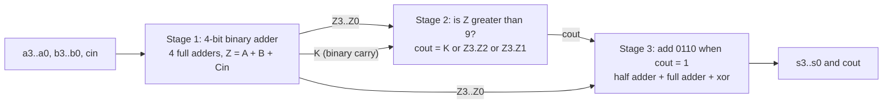
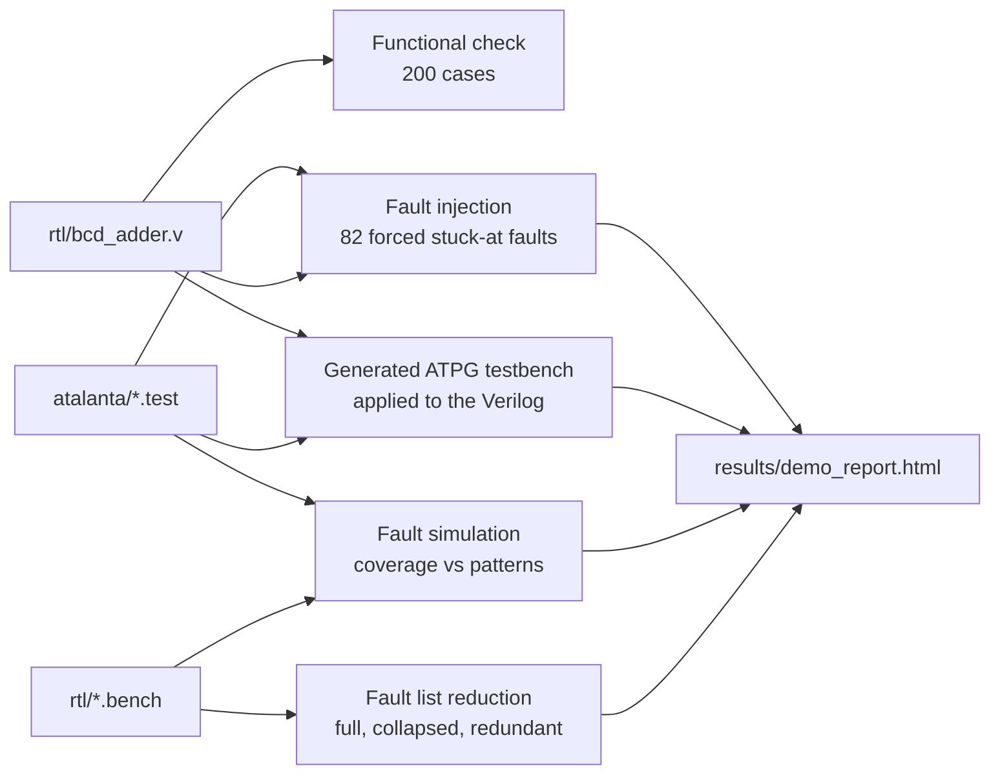
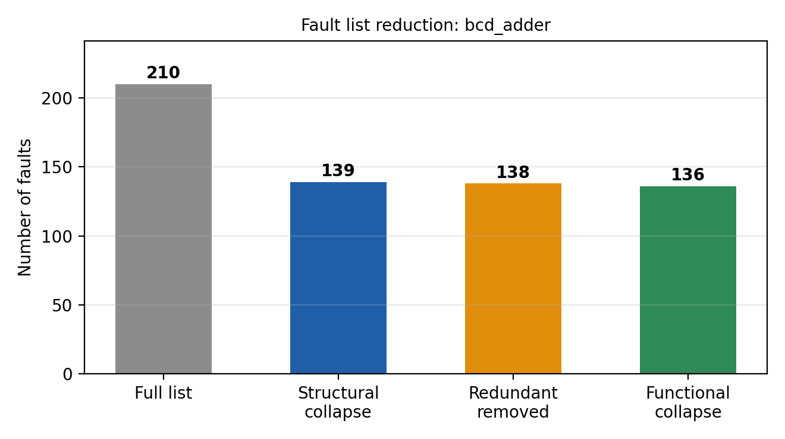

# BCD Adder: Stuck-at Fault Testing (Fault List Reduction, ATPG, Fault Simulation)

A 1-digit BCD adder written as gate-level Verilog, plus a small test flow around it: fault list reduction, ATPG patterns from Atalanta applied back to the Verilog, and stuck-at fault simulation. One command (`bash run_demo.sh`) runs everything and builds an HTML report.

This is Project 10 of 23ECE336 *VLSI Testing and Testability*. The Verilog runs in Icarus Verilog; the fault-list and fault-simulation algorithms are written in Python, so no licensed tools are needed to reproduce the results.

## Status

**Working**

- BCD adder: passes an exhaustive self-checking testbench (all 200 valid inputs, A = 0..9, B = 0..9, Cin = 0..1).
- Fault list reduction: 210 faults reduced to 136 (35.2 %) for the original circuit, and 204 to 132 (35.3 %) for the optimized one.
- One redundant (untestable) fault is found in the original circuit, `fa5_x -> fa5_c2` stuck-at-1. The optimized netlist removes the logic behind it, so every fault in it is detectable (100 % attainable coverage).
- Atalanta patterns: 14 patterns reach 99.44 % on the original circuit (the maximum, because of the redundant fault) and 15 patterns reach 100 % on the optimized one.
- The Atalanta patterns, applied to the Verilog by a generated testbench, give 0 mismatches.
- Fault injection: 82 stuck-at faults (every stem wire, SA0 and SA1) are forced inside the Verilog; the 14 patterns detect all 82.
- The whole flow is re-run automatically on every push by GitHub Actions.

**Current limitations**

- The Cadence Modus part is **not run in this repo**. `modus/modus_commands.txt` is the command script for the lab machine (Modus is licensed). `scripts/fault_sim.py` is a Python stand-in that reproduces the C70 / HS / GP / MP style experiments, so those numbers are not Modus numbers.
- Atalanta itself is not included. Its output (`atalanta/*.test`, `*.vec`, `*.ufaults`) is committed, so everything downstream can be reproduced, but regenerating the patterns needs Atalanta installed.
- The optimized circuit exists only as a `.bench` netlist (`rtl/bcd_adder_opt.bench`), not as Verilog.
- 5 of the 14 Atalanta patterns use inputs that are not valid BCD (a digit above 9), because ATPG treats the circuit as plain logic. The report marks them.
- The three scripts count faults differently, so their totals differ on purpose: the reduction script counts every input pin and gate output (210), the fault simulator counts signals and fan-out branches (180), and the Verilog injection forces stem wires only (82).
- The circuit is too small to measure CPU time, so "efficiency" is coverage per pattern.

**Possible next steps**

- Run the Modus script on the lab machine and add its results next to the Python numbers.
- Add a Verilog version of the optimized adder and run it through the same testbenches.
- Generate patterns that only use valid BCD inputs and compare the pattern count and coverage.

## Repository layout

```
rtl/
  bcd_adder.v                gate-level BCD adder (Verilog primitives only)
  bcd_adder.bench            same circuit as an ISCAS .bench netlist
  bcd_adder_opt.bench        optimized netlist, redundant carry logic removed
tb/
  tb_bcd_adder.v             exhaustive self-checking testbench (200 cases)
atalanta/                    Atalanta output: .test patterns, .vec, .ufaults (untestable faults)
scripts/
  fault_list_reduction.py    fault list reduction (stage by stage) + bar graph
  fault_sim.py               stuck-at fault simulator, C70/HS/GP/MP experiments, testbench writer
  demo_report.py             decoded patterns, worked examples, HTML report, fault-injection testbench
modus/modus_commands.txt     Cadence Modus command flow (run on the lab machine)
docs/                        step-by-step procedure document for the assignment
   results                   generated by run_demo.sh (fault lists, graphs, logs, demo_report.html)
run_demo.sh                  runs the whole flow and checks the results
```

## The circuit



The adder is built only from Verilog gate primitives (`and`, `or`, `xor`, `buf`) so that every wire can be faulted. The optimized netlist replaces the carry out of the bit-2 correction adder with `c2 = cout AND (z1 OR z2)`, which removes the redundant fault.

## The test flow



## Results

| | Original | Optimized |
|---|---:|---:|
| Gates | 32 | 31 |
| Full fault list (pins + outputs) | 210 | 204 |
| After structural collapse | 139 | 133 |
| After removing redundant faults | 138 | 133 |
| After functional collapse | **136** | **132** |
| Redundant faults | 1 | 0 |
| Atalanta patterns | 14 | 15 |
| Max attainable coverage | 99.44 % | 100 % |

Fault simulation experiments (Python stand-in for the Modus runs; efficiency = coverage / patterns):

| Mode | Meaning | Original: patterns / coverage | Optimized: patterns / coverage |
|---|---|---:|---:|
| HS | first pattern only | 1 / 37.78 % | 1 / 37.21 % |
| C70 | fewest patterns for at least 70 % | 5 / 73.33 % | 4 / 70.93 % |
| GP | first N/3 patterns | 5 / 73.33 % | 5 / 77.91 % |
| MP | all patterns | 14 / 99.44 % | 15 / 100 % |



Open `results/demo_report.html` in a browser for the decoded patterns, worked examples of how a fault shows up at the outputs, every log, and both graphs.

## Run it

You need [Icarus Verilog](https://steveicarus.github.io/iverilog/), Python 3 and matplotlib. On Ubuntu (or WSL on Windows):

```
sudo apt install iverilog python3-matplotlib
bash run_demo.sh
```

The script prints a pass/fail line for each self-check at the end and exits non-zero if one fails. Outputs go to `results/`.

To run the pieces by hand (from inside `results/`):

```
cd results
iverilog -o sim.out ../rtl/bcd_adder.v ../tb/tb_bcd_adder.v && vvp sim.out
python3 ../scripts/fault_list_reduction.py ../rtl/bcd_adder.bench
python3 ../scripts/fault_sim.py ../rtl/bcd_adder.bench ../atalanta/bcd_adder.test
```

## Cadence Modus

`modus/modus_commands.txt` lists the Modus commands for this circuit (`build_model`, `build_testmode`, `build_faultmodel`, `create_logic_tests`, `report_fault_statistics`, `write_vectors`, and the coverage-limited and HS / GP / MP runs). Modus is only available on the lab machine, so paste the commands there one at a time and check the log after each. The reduced-fault-list step depends on a subset command that is not in the course slides, so ask your instructor for its exact options.

## Docs

`docs/BCD_Project_Step_by_Step_Procedure.docx` is the step-by-step assignment guide. It describes an earlier folder layout, so file names and paths in it differ from this repo.

## Authors

| Name | GitHub |
|---|---|
| [Asmitha Sathya Niranjan] | [@Asmitha Sathya Niranjan](https://github.com/your-username) |
| [A Harika] | [@A Harika](https://github.com/your-username) |
| [Raaga Mayuri] | [@Raaga Mayuri](https://github.com/your-username) |
## License

MIT, see [LICENSE](LICENSE).
